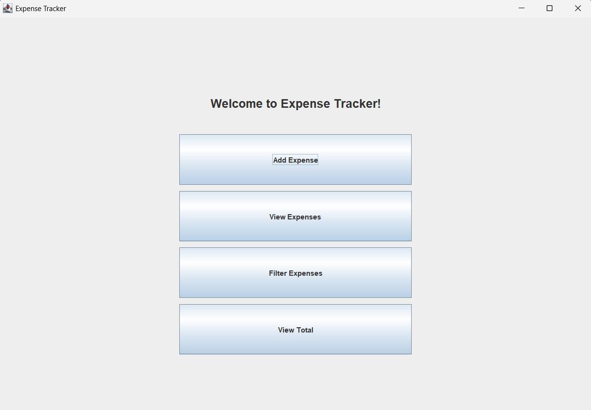
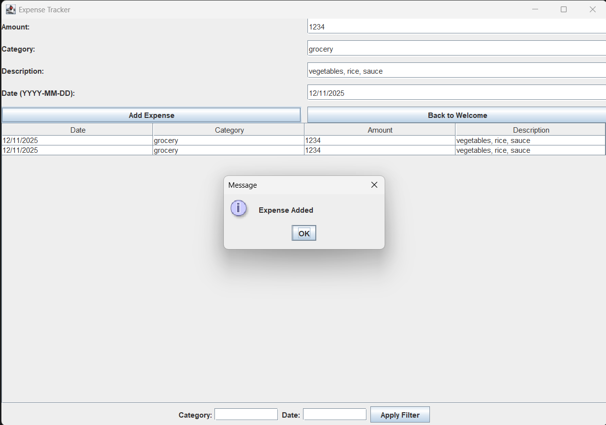

# Expense Tracker

A small desktop app for recording and reviewing personal expenses, written in Java with Swing. Add an expense, see all your expenses in a table, filter them by category or date, and check the total.

> **Status:** learning project / prototype. Expenses are kept in memory only, so they are lost when you close the app. See [Limitations](#limitations).

---

## Screenshots

| Landing page | Tool page |
|---|---|
|  |  |

## Contents

- [Features](#features)
- [Requirements](#requirements)
- [Getting started](#getting-started)
- [How to use it](#how-to-use-it)
- [Project structure](#project-structure)
- [How it works](#how-it-works)
- [Limitations](#limitations)
- [Ideas for improvement](#ideas-for-improvement)
- [Author](#author)
- [License](#license)

---

## Features

- **Welcome screen** with buttons for the main actions.
- **Add an expense** with a date, category, amount and description.
- **View expenses** in a table (Date, Category, Amount, Description).
- **Filter** the table by category (not case-sensitive) and/or by date.
- **View total** of all expenses, shown in rupees (₹).

## Requirements

- **Java Development Kit (JDK) 8 or newer.** The code compiles on Java 8 and on newer versions such as Java 21.
- A computer with a display, because it opens a window.

Check your version with:

```bash
java -version
javac -version
```

## Getting started

### 1. Get the code

```bash
git clone https://github.com/<your-username>/<your-repo-name>.git
cd <your-repo-name>
```

### 2. Compile

Run this from the folder that **contains** the `expensetracker` folder (the `src` folder in the layout below):

```bash
javac -d out src/expensetracker/NewExpenseTracker.java
```

### 3. Run

```bash
java -cp out expensetracker.NewExpenseTracker
```

A window called "Expense Tracker" opens.

**Using an IDE instead:** open the project in IntelliJ IDEA, Eclipse, NetBeans or VS Code (with the Java extension pack), then run the `NewExpenseTracker` class.

## How to use it

1. On the **welcome screen**, choose **Add Expense**, **View Expenses** or **Filter Expenses**. All three open the same expenses screen. **View Total** shows the total straight away.
2. To **add an expense**, fill in the four boxes and click **Add Expense**:
   - Amount: a number, for example `250` or `99.50`
   - Category: for example `Food`
   - Description: a short note
   - Date: in `YYYY-MM-DD` format, for example `2026-11-06`
3. To **filter**, type a category and/or a date at the bottom, then click **Apply Filter**. To show everything again, clear both boxes and click **Apply Filter**.
4. Click **Back to Welcome** to return to the first screen.
5. Click **View Total** on the welcome screen to see the sum of all expenses.

## Project structure

```
expense-tracker/
├── README.md
├── .gitignore
└── src/
    └── expensetracker/
        └── NewExpenseTracker.java    # the whole application
```

## How it works

- The window is a `JFrame` with a `CardLayout`, which swaps between two screens: the **welcome panel** and the **expense panel**.
- Expenses live in a `DefaultTableModel` shown in a `JTable`, so they exist only while the program runs.
- Filtering uses a `TableRowSorter` with regular-expression filters on the category and date columns.
- The total is calculated by adding up the amount column.
- The interface is built when the program starts, on Swing's event thread (`SwingUtilities.invokeLater`).

## Limitations

These are known and honest gaps in the current version:

- **Nothing is saved.** Closing the app deletes all expenses.
- **No input checking.** The amount is not validated when you add it. If a row has a non-number amount (for example `abc` or an empty box), **View Total** will fail with an error.
- **The total always covers all rows,** including ones hidden by the filter.
- **Dates are plain text,** not checked for the correct format, and the date filter matches text, not date ranges.
- **View Expenses and Filter Expenses open the same screen** as Add Expense.
- **No edit or delete** for an expense after it is added.
- **Currency is fixed to ₹.**

## Ideas for improvement

- Save and load expenses from a file (CSV) or a database such as SQLite.
- Check that the amount is a positive number and the date has the right format.
- Add edit and delete buttons.
- Show the total for the filtered rows, and totals per category.
- Use a date picker instead of a text box.
- Split the code into separate classes (for example `Expense`, `ExpenseStore` and the screens).
- Add a chart of spending by category.
